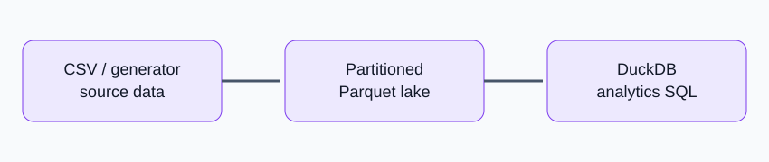

# Kenya Agricultural Prices Data Lake



A local lakehouse-style project that writes partitioned Parquet and queries it with DuckDB. The bundled generator creates synthetic prices; it is not a KAMIS data extract.

## Run
```bash
docker compose up --build
```
Files appear under `data/warehouse/`. Query on host:
```bash
pip install -r requirements.txt
python -m app.query
```

`app.ingest_csv.load_verified_csv()` accepts a CSV with `observation_date,county,market,commodity,unit,price_kes`. Use only a dataset whose source and reuse terms you have verified.

## Design decisions
Parquet is columnar and compact. DuckDB allows analytical SQL without operating a database server. Partitioning by year/month/county supports common filters; avoid over-partitioning into tiny files. Terraform/S3 is an optional extension, not required for this local demonstration.
